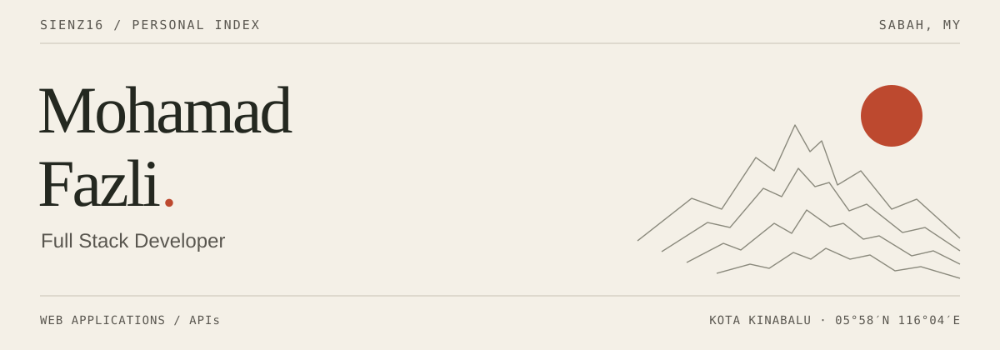
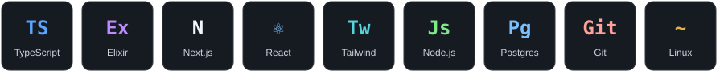

 

I’m **Mohamad Fazli**, a developer from **Kota Kinabalu, Sabah** 🇲🇾

I enjoy making things for the web, figuring out how they work, and learning as I go. Most days that means **TypeScript**, **Elixir**, and a side project that started with “what if…”.

Have a look around! If something here is useful to you, or you spot something I could do better, I’d love to hear it. Open an issue in the project and say hi 👋

### A little of what I work with

  

### Lately on GitHub

These cards update automatically. Click through to explore my activity or repositories.

### Things I’ve been building

<table>
<tr>
<td width="50%" valign="top">
<h3>🌙 <a href="https://github.com/Sienz16/ramadan-ku">ramadan-ku</a></h3>

A little companion for Ramadan in Malaysia, with prayer times, suhoor and iftar info, daily duas, and a Hijri countdown.

TypeScript
</td>
<td width="50%" valign="top">
<h3>🚗 <a href="https://github.com/Sienz16/uniplay">UniPlay</a></h3>

An Android Auto receiver for Android head units, over wireless or USB. Still in early alpha — come follow along!

Kotlin · Android · Android Auto
</td>
</tr>
<tr>
<td width="50%" valign="top">
<h3>💱 <a href="https://github.com/Sienz16/exchange.io">exchange.io</a></h3>

A currency exchange web system and API. Some of my work on the backend side of things.

TypeScript
</td>
<td width="50%" valign="top">
<h3>🧮 <a href="https://github.com/Sienz16/Malaysia-Payroll">Malaysia-Payroll</a></h3>

Exploring Malaysian payroll calculations with Elixir. Still experimental, and still learning along the way.

Elixir
</td>
</tr>
</table>

Also tinkering with [**MaskOff**](https://github.com/Sienz16/MaskOff), a tool for investigating model masking in AI gateways.

[See what else I’m working on →](https://github.com/Sienz16?tab=repositories)

### A hungry little contribution snake 🐍

<picture>
  <source media="(prefers-color-scheme: dark)" srcset="./assets/github-contribution-grid-snake-dark.svg" />
  <source media="(prefers-color-scheme: light)" srcset="./assets/github-contribution-grid-snake.svg" />
  
</picture>

---

Thanks for stopping by. Hope you find something worth exploring 🙂

